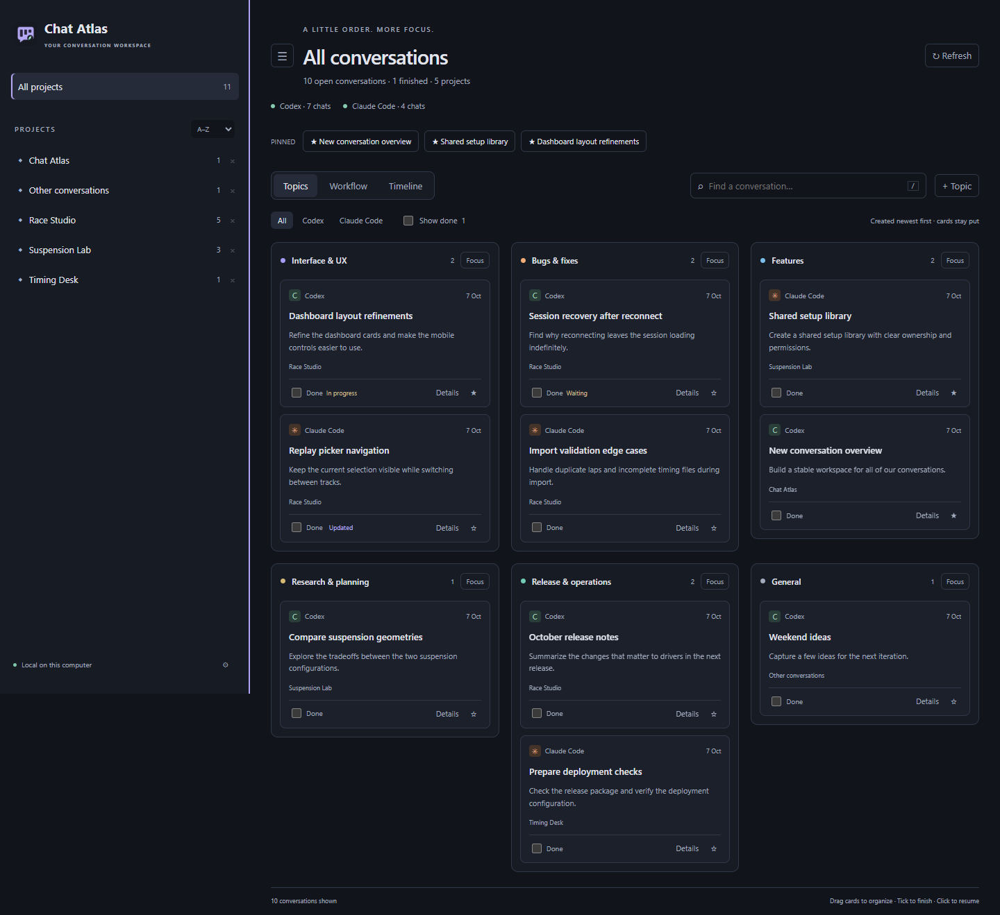

# Chat Atlas by LPX

A local VS Code extension that gives Codex and Claude Code conversations a stable home. Topics stay visible, cards keep their position when messages arrive, and a Done checkbox separates finished tasks from active work.

## Start

Install [Chat Atlas by LPX](https://marketplace.visualstudio.com/items?itemName=LPX.lpx-conversation-board) from the VS Code Marketplace, or run:

```powershell
code --install-extension LPX.lpx-conversation-board
```

Run **Chat Atlas: Open Board** from the Command Palette, or press **Ctrl+Alt+A** (macOS: **Cmd+Alt+A**). After first activation, **Chat Atlas** is also available in the status bar. Keep the board in the editor while working in the provider sidebar. While the board is focused, **Ctrl+N** (macOS: **Cmd+N**) starts a new chat in the selected project; change it with **Chat Atlas: Change New Chat Shortcut**.

The published extension ID is `LPX.lpx-conversation-board`. Earlier packages used `local-tools.chat-atlas` or `lpx.chat-atlas`, separate extension identities with separate organization metadata. When switching, disable earlier installations to avoid duplicate commands. Existing transcripts are unaffected.

The current local package is **chat-atlas-0.1.54.vsix**. Published installers are available from the [latest GitHub release](https://github.com/dloppini/chat-atlas/releases/latest). Use **Extensions → … → Install from VSIX…** to install a package.

Select a project and open **Engineering** to review its repository, explore local file dependencies, or trace the impact of a change. Choose **Refresh analysis** to capture a snapshot. **Chat Atlas: Select Project** opens the same project selection from the Command Palette. Agents can query the same evidence through a local MCP server; choose **Connect agents** in Engineering to register it with Claude Code and Codex. See the [Engineering Control Center guide](ENGINEERING-CONTROL-CENTER-SPEC.md) for setup, coverage and verification.



Requires VS Code 1.96 or newer and local conversation history from Codex or Claude Code. An installed provider extension or CLI is needed to resume chats. Chat Atlas is an independent community project, unaffiliated with OpenAI or Anthropic.

## Working across folders

- Set **Chat Atlas: Claude Tile Action** to **terminal** to focus an integrated terminal when you select a Claude chat title. Details also lets you explicitly open the chat window or start a hidden terminal.
- Choose **Details > Browse files in VS Code** to inspect a chat's working folder. Workspace folders open in Explorer. External folders appear in **Chat Atlas Files** in the same Explorer sidebar. Use its refresh button after files change.
- After moving or renaming a working folder, select the old project and choose **Reconnect folder**. Browse to its current location. Atlas keeps card notes and uses the original session ID to resume. Claude's terminal can find that ID across projects. Provider history files stay in place.
- On Windows, run **Chat Atlas: Enable Windows Explorer Project Menu** once. Right-click a folder or its background and choose **Create Chat Atlas project here** (under **Show more options** on Windows 11). Review the name and folder in the board, then create the project. Registration is per Windows user. Run **Chat Atlas: Remove Windows Explorer Project Menu** to uninstall the menu.


## Use the board

- The board opens in **Timeline** view. The installed version appears beneath **Chat Atlas** at the top of the project sidebar.
- **Topics** automatically groups new conversations using local keyword rules against titles and the first prompt. Initial topics cover interface, fixes, features, research, releases, and general work. Use **+ Topic** to define a subject and its matching keywords. This is deterministic grouping, not an AI semantic classifier.
- **Workflow** groups the same cards into Inbox, In progress, Waiting, and Done. Progress is set by you; it does not pretend to know whether an agent is running or waiting for approval.
- Cards with an unfinished turn show a **Running** ring and thin frame. Chat Atlas recognizes start, reasoning, tool, completion, and interruption records from Codex and Claude Code, including long and partially written transcripts. File notifications and a two-second activity check update the indicator without rebuilding the board. Completion and interruption stop it as soon as they are detected. The default inactivity timeout is 60 minutes; increase **Settings → Chat Atlas → Running Timeout Minutes** for longer tools or builds. Activity is inferred from local history, so a provider that buffers its transcript can delay the indicator. It is separate from the manual Workflow status.
- Columns use taller scrolling lists. Click **Focus** in any column header to show only that group with more room for its conversations. Click **Exit focus** or press **Escape** to return to the board; each view retains its scroll positions. Focus survives refreshes; a focused Timeline day also survives reopening the board. Switching between Topics, Workflow, and Timeline returns to the overview.
- **Timeline** lists conversations by creation date, newest first. Wide panes align the title, project, provider, and actions in a row; narrower panes stack the same information. By default all views order cards by creation time so new messages do not reshuffle them, and new conversations enter at their chronological position.
- Every card shows when its conversation was last active, such as **Active 3h ago**. Choose **Sort → Last updated** beside **Show done** to put the most recently active chats first; Timeline then groups them by the day they were last active. **Newest first** restores creation order.
- Tick **Done** on any card. It is saved locally and hidden from the active board. Enable **Show done** to see finished cards, then untick to reopen one. This never archives or deletes the original conversation.
- Click a card title to resume it. Use **Details** for excerpts, editable board titles, topic/progress selectors, and a handoff note. These selectors also provide a keyboard alternative to drag and drop.
- Drag cards between topics or workflow columns. Manual topic choices are retained. Existing cards are not automatically reclassified after a new topic is created.
- Pin important chats with the star. Their shortcuts remain visible above the board.
- Use the sidebar toggle beside the page heading to hide or show the project list and give the board more space. Your choice is remembered when you reopen the board. Opening details or moving a task preserves that choice; in narrower desktop windows, details overlay the board. On phones, the same toggle opens the project navigator. Selecting a project or pressing Escape dismisses it without changing your desktop preference.
- Drag the sidebar's right edge to resize it. Its width is saved across board reopenings and VS Code restarts. Focus the edge and use the arrow keys to adjust it, or double-click it (or press Enter) to restore the default width. The board adapts to the available space.
- Cards preview the latest conversation message, skipping internal context metadata. Handoff notes remain available in Details.
- Filter by project/provider or search titles, latest message previews, topics, projects, and notes. Press **/** to focus search. **Escape** closes details.
- Select a project and choose **Rename project** beside its folder path. The saved board name changes; folders and chat assignments stay unchanged.
- Equivalent Windows path spellings share one project entry. Different folders with the same project name stay separate and show their paths below the name. Hover an entry to see its full folder path.
- Choose **Show subfolders** beneath **PROJECTS** to see one folder level below each project. The parent project still shows all its conversations, and hiding the folder level restores the original project view. Chat Atlas suggests a folder when the recorded working directories clearly point to one; use **Details → Subfolder within project** to assign or correct a conversation. Chats without a clear folder remain under **Project root**. Folder choices are saved with the card and do not change the original transcript or its working directory.
- Projects follow each conversation's recorded working folder by default. In **Details → Project**, choose another existing project or create one for an exception; choose **Automatic** to restore folder-based grouping. The warning in Details explains that manual placement only changes Chat Atlas. Use the **+** beside **PROJECTS** to create an empty project. Enter an existing folder path or choose **Browse…** when creating it; leaving the folder blank creates a board-only label. You can select that project later and use **Link folder…** beneath its title to add a folder while keeping its assigned chats. Linked folder paths appear in the project subheader, and future chats started there group automatically. Neither option creates a folder or changes a transcript.
- Select a folder-backed project and click **+ Chat**, or use the **+** beside its name. Codex opens its sidebar with the selected working folder. Claude opens a new sidebar chat. For another project, Atlas fills in the folder instruction. Append your task and press Send. Claude retains the workspace as its session directory. Atlas recognizes the sent instruction and files the card under the selected project. Close a tab and use **Resume in Claude Code** on its Atlas card to retrieve the original conversation. New cards appear after the first message and the next history refresh. A project without a folder first opens the folder-linking dialog.
- A spinner beside a sidebar project name means at least one of its chats has a running task. Hover it for the running count. It follows the card indicators, including chats hidden by search or completion filters, and clears when all of the project's tasks stop.
- Use **×** beside a project to remove its sidebar entry. Its chats remain in **All projects**; use **Hidden projects** to restore it. Choose **A–Z** or **Manual** beside **PROJECTS**. In Manual mode, drag projects or focus a project and press **Alt+Up/Down** to reorder it. Your manual order is retained when switching to alphabetical sorting, and sidebar preferences survive reopening the board and restarting VS Code.
- Moving a task to an existing or newly created project keeps your current project selected and its details open. Moving the last task out leaves the selected project visible with a zero count.

## Provider integration

| Provider | Discovery | Resume |
| --- | --- | --- |
| Codex | `CODEX_HOME/sessions`, otherwise `~/.codex/sessions`; titles from `session_index.jsonl` | Installed `openai.chatgpt` sidebar via session URI; optional editor beside board; explicit CLI action |
| Claude Code | `CLAUDE_CONFIG_DIR/projects`, otherwise `~/.claude/projects` | New sidebar drafts; resume by original session ID and directory; explicit CLI action |

Cross-project native tabs currently support verified Windows Claude Code bundles 2.1.323 and 2.1.325 through 2.1.330. Atlas opens these tabs beside the board and reuses the side group. This compatibility bridge temporarily supplies the directory during native tab construction; Claude keeps its own toolbar, permissions, model selection, and authentication (including API configuration managed by Claude). Chat Atlas does not patch installed Claude files or project settings. Unknown builds are rejected before opening. Claude updates require revalidation. Native tab auto-restoration after restarting VS Code is not covered; retrieve saved chats through Atlas, closing a stale restored tab first if necessary.

By default, Chat Atlas opens an existing conversation through its installed provider extension. If that extension is unavailable, Chat Atlas shows an error instead of opening a terminal. The separate **Hidden terminal** action runs the corresponding CLI without revealing the Terminal panel; open that panel when you want to interact with it. The CLI must be installed and signed in. Provider integration can change with provider updates. The native resume flows have not been verified live for this release; parser and routing checks use fixtures. See [integration notes](https://github.com/dloppini/chat-atlas/blob/main/CONTRIBUTING.md#provider-integration-notes) for the tested versions and routing details.

Only local history is indexed. Cloud-only chats, Codex archived sessions, Claude subagent transcripts, and remote hosts are not discovered automatically. Local source folders can be changed in **Settings → Chat Atlas**. The extension runs on the local UI host in SSH/WSL windows; explicitly point it at an accessible history folder when needed.

## Local data and limits

The extension has no production dependencies, network requests, telemetry, model calls, or API-key requirement. It reads conversation files and stores only organization metadata in VS Code's extension global state (per profile, shared between workspaces). It does not modify provider transcripts or read provider authentication files. Conversations are sampled in memory: up to 256 KiB from the start and 128 KiB from the end, with recent plain-text excerpts shown in Details. Search indexes the full conversation text.

The default limit is 1,000 recent transcript files per provider, configurable up to 10,000. Full refresh runs every 20 seconds while the board is visible; activity checks run every two seconds, and file notifications can discover new conversations sooner. Cached file signatures avoid rereading unchanged transcripts. Scan errors and missing folders are visible on the board. Completion, notes, and grouping survive VS Code restarts. Separate VS Code windows should not edit the same board metadata simultaneously in this first version; cross-window conflict resolution is not implemented.

## Development

See [Contributing](https://github.com/dloppini/chat-atlas/blob/main/CONTRIBUTING.md) for development setup, the fictional-data preview, architecture, and provider integration notes.

## Community

[Report a bug or suggest a feature](https://github.com/dloppini/chat-atlas/issues). Please remove private conversation text and personal paths from reports. See [Contributing](https://github.com/dloppini/chat-atlas/blob/main/CONTRIBUTING.md) for development guidance. Released under the [MIT license](https://github.com/dloppini/chat-atlas/blob/main/LICENSE.txt).

### Feedback

Use the **bug icon** beside Refresh to report a bug, request a feature, or view existing reports. The native VS Code picker opens [Chat Atlas Issues](https://github.com/dloppini/chat-atlas/issues) in your browser. New reports start as editable drafts with a `[Bug]` or `[Feature]` title and app, VS Code, and platform versions. GitHub sign-in is required to submit; reports are public. Conversation content, project paths and logs are not attached automatically.

### Git dashboard

Select a folder-backed project, then choose **Git** beside **+ Chat**. The dashboard shows the current branch, local and remote branches, the latest 100 commits as a topology graph, and staged, unstaged, and untracked paths. **Refresh** reloads the repository snapshot; **Chats** returns to your conversation view. Remote refs reflect local Git data until you choose Fetch. Fetch updates all configured remotes. Pull requires a clean working tree and fast-forwards the current branch; Push sends the current branch to its configured upstream without forcing. For a branch without an upstream, select its remote and use Push to publish it and set tracking. Git must be installed.

Stage or unstage the selected file from its diff toolbar, or use **Stage all / Unstage all** for the current comparison. Enter a **Commit message** (with an optional multiline description) and choose **Commit staged**. Only staged changes are included; drafts survive refresh, project switches and window reloads. Git identity, signing and hooks use your existing configuration.

For Azure DevOps Services repositories, **Create PR** opens the Azure PR creation form with the source branch selected. Push the branch first, then choose the target, title, description and reviewers in your authenticated browser and submit there. Azure HTTPS and SSH remotes are supported; choose the **PR remote** when more than one remote is configured. Self-hosted Azure DevOps Server is not detected.

The graphical history connects commits to their parents and shows refs, authors, dates, and hashes. Select a commit to inspect its changed files. **All** shows staged, unstaged, and untracked files together in Local changes, with yellow **M** for modified files and green **N** for new files. Select **Unstaged**, **Staged**, or **Untracked** for a narrower comparison. Unified diffs include old/new line numbers and added/deleted line highlighting. Merge comparisons use the first parent. Text previews are limited to 512 KB. Binary content is identified without rendering.

### Pick up and hand off work

- Right-click a local file in Explorer and choose **Chat Atlas: Find Chats for This File**. Select a result to resume the chat. Recorded edit and read actions appear before path mentions.
- Open a project and choose **Project pickup** for chats with a running task and those marked In progress or Waiting. Edit the next step in the chat’s handoff note.
- Search the board and choose **Passages** on a result, or use **Find passage…** in Details. Pick a message to open the match and the messages on either side in an editor.
- In Details, choose **Hand off…**, select an excerpt or write a decision, choose file paths, and enter the next step. Review the preview, then **Copy and open chat**. Paste into the new provider draft and send. Atlas links the chats in Details when it indexes the opening message with the source line.
